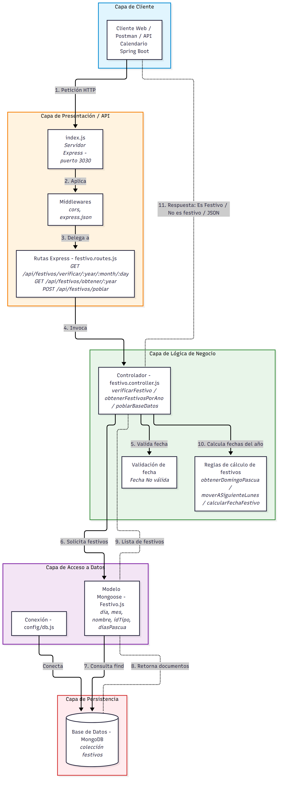
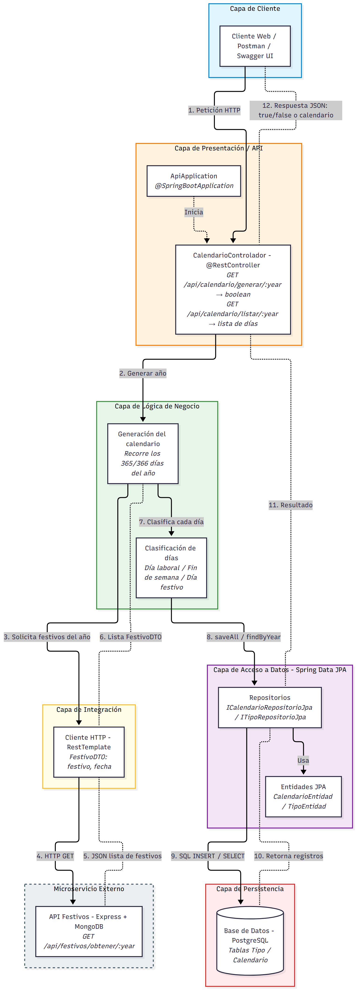
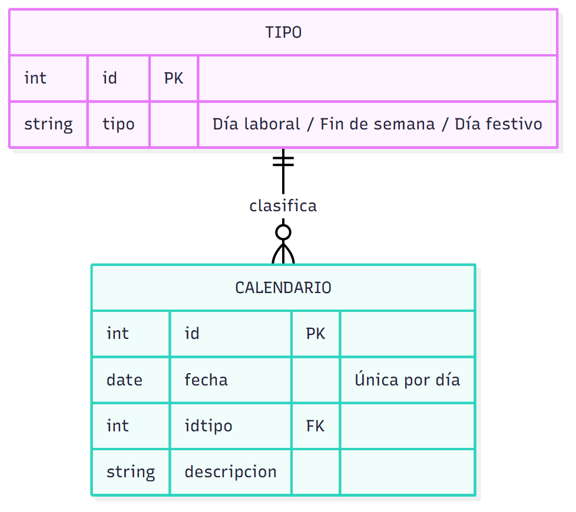
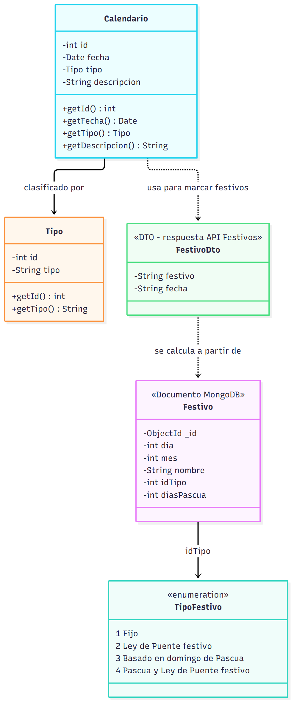

# Taller 1 - Arquitectura de Software (Microservicios)

Este repositorio contiene la solución al Taller 1: dos APIs RESTful que conforman una solución basada en microservicios.

| # | API | Tecnología | Carpeta |
|---|-----|------------|---------|
| 1 | API Festivos | Express JS + MongoDB | `/apiFestivos` |
| 2 | API Calendario (cliente de la API Festivos) | Spring Boot + PostgreSQL | `/apiMonedas` (módulo calendario) |

### Endpoints

**API Festivos** (`http://localhost:3030`)
- `GET /api/festivos/verificar/{año}/{mes}/{día}` → *Es Festivo* / *No es festivo* / *Fecha No válida*
- `GET /api/festivos/obtener/{año}` → lista de festivos del año

**API Calendario**
- `GET /api/calendario/generar/{año}` → genera y almacena todos los días del año clasificados (retorna `true`/`false`)
- `GET /api/calendario/listar/{año}` → retorna el calendario completo con los días clasificados

---

## 📐 Diagramas de Arquitectura (Mermaid)

### 1. Diagrama de Arquitectura por Capas - API Festivos (Express + MongoDB)



Código fuente: [`diagramas/festivos.mmd`](diagramas/festivos.mmd)

### 2. Diagrama de Arquitectura por Capas - API Calendario (Spring Boot + PostgreSQL)

Muestra la comunicación entre microservicios: la API Calendario consume vía HTTP GET la API Festivos.



Código fuente: [`diagramas/calendario.mmd`](diagramas/calendario.mmd)

---

## 💾 Modelado de Datos

### 3. Diagrama Relacional - BD Calendario (PostgreSQL)



### 4. Diagrama Objetual - Clases de ambas APIs



---

## 📝 Correcciones respecto a la primera entrega

- Se rehízo el diagrama de la API Festivos siguiendo el ejemplo de División Política (capa de cliente, flujo numerado de petición/respuesta, archivos y rutas reales, reglas de cálculo de Pascua y Ley de Puente).
- Se agregó el diagrama de la **API Calendario**, que no se había entregado (antes se había diagramado la API Monedas, que era solo el ejemplo del enunciado).
- Los diagramas relacional y objetual ahora corresponden a las APIs del taller (Festivos y Calendario) y no a Monedas.
- La versión en Arquitectura Cebolla (Onion) de la API Calendario se encuentra también integrada en los 5 módulos de `apiMonedas` (`dominio`, `core`, `infraestructura`, `aplicacion`, `presentacion`), además del borrador en `examen2`.

---

## 🐳 Despliegue con Docker Compose (Arquitectura Onion + Seguridad JWT)

El archivo [`docker-compose.yml`](docker-compose.yml) levanta e interconecta los 4 contenedores en la red `redcalendario` (sin requerir compilación previa en el equipo anfitrión gracias al `Dockerfile` multi-stage con Maven + Java 21):

| Contenedor | Servicio | Puerto |
|------------|----------|--------|
| `dockerbdfestivos` | MongoDB (base `festivos_db` precargada) | `27019:27017` |
| `dockerapifestivos` | API Festivos (ExpressJS + MongoDB) | `3030:3030` |
| `dockerbdcalendario` | PostgreSQL (base `calendario` + tablas `tipo`, `calendario`, `usuario`) | `5435:5432` |
| `dockerapicalendario` | API Calendario + Tipos (Spring Boot 3 / Java 21 — Onion 5 módulos + JWT) | `8080:8080` |

### 1. Levantar todo el sistema
```bash
cd "examen 1"
docker compose up -d --build
```

### 2. Autenticación JWT y endpoints protegidos
Todos los endpoints de `/api/calendario/**` y `/api/tipos/**` están protegidos con Bearer JWT (devuelven `403 Forbidden` si no se envía token):

1. **Obtener token JWT** (`GET http://localhost:8080/api/usuarios/validar/admin/admin123`)
2. **Swagger UI:** `http://localhost:8080/swagger-ui/index.html` (botón **Authorize** con el token recibido)
3. **Endpoints de Calendario y Tipos (con header `Authorization: Bearer <token>`):**
   - `GET /api/tipos/`, `GET /api/tipos/obtener/{id}`, `GET /api/tipos/buscar/{nombre}`, `POST /api/tipos/`, `PUT /api/tipos/`, `DELETE /api/tipos/{id}`
   - `GET /api/calendario/generar/{año}`
   - `GET /api/calendario/listar/{año}`

### 3. Pruebas automatizadas de integración (PowerShell)
```powershell
powershell -ExecutionPolicy Bypass -File "examen 1\test-integracion-calendario.ps1"
```
